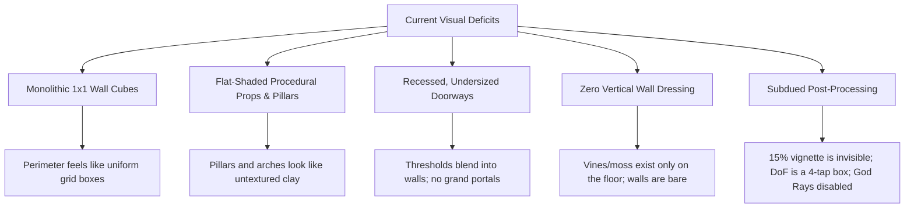
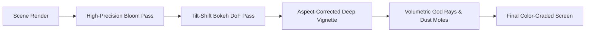

# 🎨 HD-2D Visual Overhaul Plan: Dungeon Aesthetics & Atmosphere

> **Target Benchmark:** *Dragon Quest I & II / III HD-2D Remake* and *Octopath Traveler*  
> **Core Concept:** Crisp pixel-art characters and creatures existing inside a tactile, beautifully lit, miniature 3D diorama with photographic depth, rich architectural framing, and atmospheric lighting.

---

## 1. Executive Summary & Diagnostic

While *Dungeon Crawlers* has rich gameplay systems, animated LPC/pixel sprite sheets, and procedural 3D level layouts, the environments currently suffer from several visual bottlenecks that make them feel sparse and flat:



This plan outlines a 4-phase visual overhaul that upgrades the engine's textures, geometry, procedural decorators, and post-processing shader stack without breaking the fast, instanced WebGL rendering performance.

---

## 2. The Four Pillars of the HD-2D Overhaul

### Pillar I: Procedural Texture & Material Fidelity
**Goal:** Eliminate flat, plastic-looking surfaces on pillars, arches, and walls by upgrading canvas-generated pixel atlases and UV mappings.

1. **Textured Architectural Props**:
   * Currently, props like [`GEO.pillar`](file:///g:/ClaudesFolder/dungeon-crawlers/src/render/dungeon_geo.js#L143) and [`doorPostGeo`](file:///g:/ClaudesFolder/dungeon-crawlers/src/render/dungeon_geo.js#L585) often inherit generic materials (`matStone`, `matTrim`) that lack UVs mapped to the masonry atlas.
   * Map all pillars, lintels, and plinths to the 2×2 masonry/flagstone procedural atlas in [`src/render/dungeon_materials.js`](file:///g:/ClaudesFolder/dungeon-crawlers/src/render/dungeon_materials.js) so stone blocks have chisel marks, mortar seams, and surface grain.
2. **Sharpened Pixel Normal & Bump Maps**:
   * Update [`makeAtlasTex(kind)`](file:///g:/ClaudesFolder/dungeon-crawlers/src/render/dungeon_materials.js#L48) to sharpen mortar relief and increase ambient occlusion at stone contact seams.
   * Add stylized, hand-chiseled highlight edges on top facing stone blocks to catch directional light like high-end pixel art tiles.
3. **Theme-Distinct Palette Richness**:
   * **Ancient:** Warm limestone, sandstone grit, weathered chiseled granite.
   * **Grim:** Cold blue-gray slate, cracked dark flagstones, blood-iron accents.
   * **Verdant:** Mossy damp cobblestone, ancient vine-choked bark, loam.
   * **Molten:** Obsidian, black basalt with ember-lit mortar fissures.
   * **Frost:** Translucent rime-coated stone, glacial teal ice with specular glints.

---

### Pillar II: Grand Architectural Portals & Doorways
**Goal:** Transform doorways from faint cutouts into defined, imposing architectural portals that frame the journey between rooms.

```
       Current Doorway                    Overhauled HD-2D Portal
   [ Wall ]      [ Wall ]          [ Wall ]  /════════════════\  [ Wall ]
   [ Wall ] ==== [ Wall ]          [ Wall ]  |   KEYSTONE     |  [ Wall ]
   [ Wall ] |  | [ Wall ]   ===>   [ Wall ]  |=== CROWN ======|  [ Wall ]
   [ Wall ] |  | [ Wall ]          [ Wall ]  |/|            |\|  [ Wall ]
   [======] |  | [======]          [======]  | |   HEAVY    | |  [======]
    Floor   gate  Floor             Floor   [Threshold Stone]    Floor
 (Sits lower than 2.0 wall;         (Projects outward, exceeds wall height,
  thin posts blend in)               carved capitals, contrasting stone)
```

1. **Dimensional Frame Projection**:
   * Doorway posts (`GEO.archPost_*`) currently measure 0.24–0.30 wide, sitting flush or recessed. Expand their profile to 0.45–0.55 with stepped bases and flared capitals that project outward from the wall plane.
   * Raise the lintel (`GEO.archLintel_*`) from $y = 1.88$ to $y = 2.25$, placing it *above* the standard 2.0 wall height.
2. **Theme-Authored Silhouettes**:
   * **Ancient:** Romanesque rounded arch with a stepped keystone and fluted side pilasters.
   * **Grim:** Pointed Gothic arch with iron-reinforced bracketing and skull corbels.
   * **Verdant:** Natural bower arch formed by intertwining gnarled roots and dangling foliage.
   * **Molten:** Massive jagged basalt pillars capped by a cracked, ember-glowing lintel block.
   * **Frost:** Carved ice monoliths with stalactite icicle crowns.
3. **Threshold Transition Stones**:
   * Underneath every doorway cell, render a dedicated **Threshold Flagstone** (darker, worn, weathered step stone). This creates a distinct visual demarcation between hallway corridors and chambers.

---

### Pillar III: Vertical Wall-Face Foliage & Dressing
**Goal:** Break up monolithic 1×1 wall cubes by dressing the vertical faces bordering walkways.

1. **Cardinal Wall-Face Detection**:
   * During scene assembly in [`buildScene(d)`](file:///g:/ClaudesFolder/dungeon-crawlers/src/render/dungeon_scene.js#L1006), check the 4 cardinal neighbors of every `WALL` cell:
     $$\text{Exposed Face} = \{ (dx, dy) \mid \text{grid}[x+dx, y+dy] == \text{FLOOR} \lor \text{POOL} \}$$
2. **Instanced Wall-Cling Decorators**:
   * **Verdant / Forest / Sporewood:** Hanging English ivy, creeping wall vines, and dripping root tendrils that drape down from the wall cap across the upper 40–80% of the wall face.
   * **Grim / Boneyard:** Iron wall shackles, weeping damp stains, and hanging bone charms.
   * **Frost / Snowfield:** Hanging icicle valances along the wall cornice and creeping frost patches.
   * **Molten / Ashfield:** Glowing heat fissures and soot staining trailing up from the base.
   * **Ancient:** Mortar cracks with small wall ferns and engraved masonry reliefs.
3. **Pilasters & Buttresses (Rhythmic Cadence)**:
   * On straight wall runs longer than 4 tiles, place a protruding pilaster/buttress column every 3 tiles. This breaks up flat horizon lines and catches directional shadows.

---

### Pillar IV: Cinematic HD-2D Post-Processing & Atmosphere
**Goal:** Deliver the signature photographic tilt-shift, deep vignetting, and volumetric lighting of HD-2D games.



1. **Aspect-Corrected Deep Vignette**:
   * **Current:** Flat 15% reduction in screen corners (`mix(0.85, 1.02, vg)`), practically invisible.
   * **Overhaul:** Elliptical, aspect-ratio corrected formula darkening corners by **40%–55%**:
     ```glsl
     vec2 uvCenter = (vUv - 0.5) * vec2(uRes.x / uRes.y, 1.0);
     float vig = smoothstep(0.95, 0.35, length(uvCenter) * 1.35);
     col *= mix(0.48, 1.0, vig);
     // Subtle shadow tinting matching theme mood
     col = mix(col * uShadowTint, col, vig);
     ```
2. **Camera-Aligned Tilt-Shift Depth of Field (DoF)**:
   * **Current:** 4-tap box sample on a fixed horizontal screen band.
   * **Overhaul:** 
     * Implement a multi-tap (8–12 tap) circular Poisson/disc bokeh blur kernel.
     * Calculate the focal plane aligned with the isometric camera's ground angle ($\text{pitch} \approx 0.64$). The active party stands in pinpoint sharp focus; foreground tiles (bottom) and distant high ceilings/backdrops (top) fade into smooth optical bokeh.
     * Add subtle chromatic aberration (color fringing) on out-of-focus highlights.
3. **Volumetric God Rays & Dancing Dust Motes**:
   * **Re-enable Light Shafts**: Re-activate and upgrade [`GEO.shaft`](file:///g:/ClaudesFolder/dungeon-crawlers/src/render/dungeon_geo.js#L681) and [`matShaft`](file:///g:/ClaudesFolder/dungeon-crawlers/src/render/dungeon_materials.js#L747) currently disabled at line 2224 of [dungeon_scene.js](file:///g:/ClaudesFolder/dungeon-crawlers/src/render/dungeon_scene.js).
   * **Strategic Placement**: Cast angled light rays through:
     * Ceiling grates and vault cracks into large rooms.
     * Directly illuminating the Boss sarcophagus/throne, Shrines, and Treasuries.
     * Sun-dappled canopy openings on overland biomes (`forest`, `sporewood`).
   * **Luminous Dust Motes**: Re-activate the particle pass (`spec.kind === 0`) to spawn gentle, glowing dust particles drifting slowly through the light cones.
4. **Emissive Bloom & Torch Bounce**:
   * Slightly expand the threshold bloom pass so torches, braziers, glowing runes, and molten lava cast a soft, warm atmospheric halo over nearby stonework.

---

## 3. Phased Implementation Roadmap

| Phase | Subsystem | Files Involved | Scope & Deliverables |
|---|---|---|---|
| **Phase 1** | **Cinematic Post-Processing** | `src/render/dungeon_materials.js`<br>`src/render/dungeon_scene.js` | • Implement aspect-ratio corrected deep vignette (40-50% attenuation)<br>• Upgrade DoF to multi-tap Poisson disc bokeh kernel with camera-plane focus<br>• Add shadow color tinting (cool blue for grim/frost, warm amber for ancient) |
| **Phase 2** | **Volumetric God Rays & Motes** | `src/render/dungeon_scene.js`<br>`src/render/dungeon_materials.js` | • Re-enable light shaft geometry (`GEO.shaft`, `matShaft`)<br>• Align light shafts to directional sun/moon angles<br>• Place shafts over key rooms (Shrines, Boss, Vaults)<br>• Re-enable drifting dust motes in active light cones |
| **Phase 3** | **Architectural Portals & Doorways** | `src/render/dungeon_geo.js`<br>`src/render/dungeon_scene.js`<br>`src/dungeon/dungeon_generator.js` | • Redesign door posts and lintels to project out from wall planes<br>• Raise lintels to 2.25 with decorative keystones and crown caps<br>• Add theme-specific portal styling (Gothic, Romanesque, Root bower)<br>• Add threshold flagstone meshes under doorways |
| **Phase 4** | **Vertical Wall Dressing & Foliage** | `src/render/dungeon_scene.js`<br>`src/render/dungeon_geo.js`<br>`src/render/dungeon_materials.js` | • Cardinal neighbor detection for exposed wall faces<br>• Instanced wall-cling foliage (ivy, moss, icicles, heat fissures)<br>• Pilasters / buttress spacing on straight walls longer than 4 tiles<br>• Texture UV atlas mapping for pillars and stone furniture |

---

## 4. Performance & Quality Tier Safeguards

To ensure the game runs smoothly across standard browser windows and Electron:
* **Instancing Everything**: All wall foliage, pilasters, and light shafts will use `InstancedMesh` with matrix arrays, introducing **zero extra draw calls**.
* **Quality Scaling ([options_ui.js](file:///g:/ClaudesFolder/dungeon-crawlers/src/game/options_ui.js))**:
  * **Low Quality**: Simple vignette, disabled DoF, disabled god rays, low-density wall foliage.
  * **Medium Quality**: Full vignette, 6-tap DoF, god rays on key rooms, standard wall foliage.
  * **High Quality**: Full vignette with shadow tinting, 12-tap Poisson bokeh DoF with chromatic fringing, full volumetric god rays with dust motes, rich foliage density.

---

> [!TIP]
> **Implementation Note When Resuming:**
> Starting with **Phase 1 (Post-Processing: Vignette & DoF)** will immediately yield a massive visual transformation across *every single existing level* without altering room generation, followed by **Phase 2 (God Rays)** and **Phase 3 (Doorways & Walls)**.
